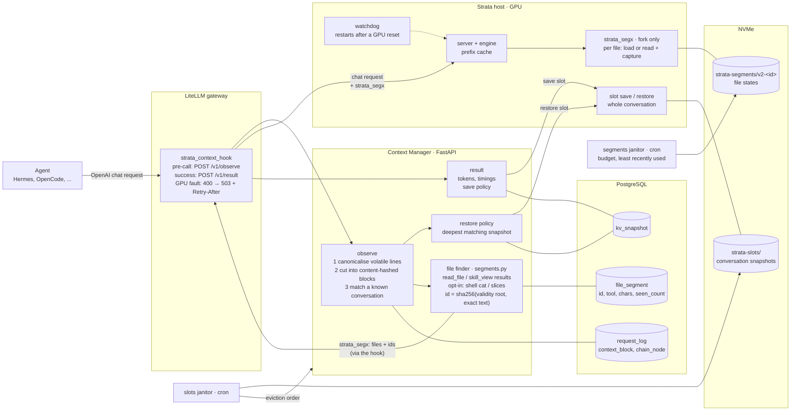
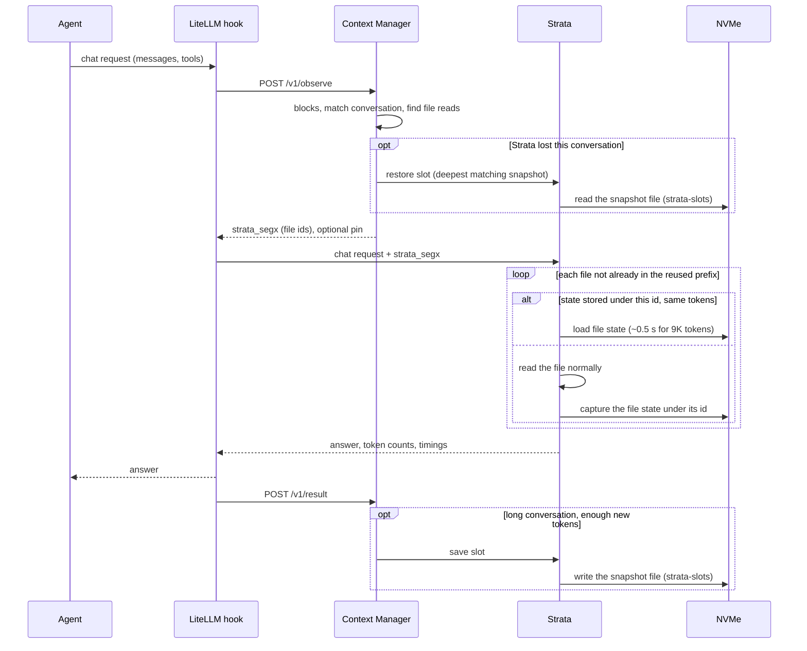

# strata-context-manager

A persistent context cache for the [Strata](https://github.com/Niko1221/Strata) inference engine, plugged into the
[LiteLLM](https://github.com/BerriAI/litellm) proxy. It saves what the model has already read to disk and reloads it
when the engine has forgotten it, so AI agents wait far less for prompt reading (prefill).

Built and measured with [Hermes Agent](https://github.com/nousresearch/hermes-agent) and **Qwen3.8-Flash-Next**
(IQ2_XS) on one AMD MI100. Any OpenAI-compatible client that goes through LiteLLM benefits.

## In five sentences

An AI agent re-sends its whole conversation to the model at every step, so the model would normally re-read
everything from the start each time, which is slow on a home GPU. This system saves what the model has already read
to a fast disk, like a bookmark, so the next step only reads what is new. If the server restarts, crashes or a new day
starts, the bookmark is reloaded in about a second instead of re-reading the conversation for tens of seconds or
several minutes. For agents that work on the same project over long sessions or several days, that means far less
waiting: up to 20 times less on the first answer after a restart. It does not help when every task is new and
unrelated.

**And Strata's own cache?** Strata already remembers the last few conversations in GPU and RAM while it runs, so one
uninterrupted session is already fast. That memory is small and temporary: it is lost on a restart or crash, and older
conversations get pushed out. This project adds the long-term memory on disk, and smooths out details that would break
the bookmark, such as the date an agent writes at the top of every conversation.

## Measured (Hermes writing this lab's infrastructure docs, 21 Nov 2026)

| Prefill wait | No reuse | Strata cache only | Strata + this project |
|---|---:|---:|---:|
| Whole docs task with one Strata restart | 674.8 s | 135.0 s | **83.7 s** |
| One uninterrupted session (21 calls) | 516.6 s | 69.0 s | 67.7 s |
| First call after a restart / GPU reset (~38K tokens) | 47.7 s | 43.6 s | **2.2 s** |
| First call of a new day (10.5K-token system prompt) | 12.5 s | 12.5 s | **0.9 s** |

One run per setup; method, raw numbers and limits in [docs/BENCHMARK.md](docs/BENCHMARK.md).

## How it fits together



* **LiteLLM hook**: before each request, sends the messages to the Context Manager's `/v1/observe` and adds what it
  answers to the request (`strata_segx` for the file cache, `strata_prefix` for the optional pin, the canonicalised
  messages when `CTX_REORDER=1`). After the request, reports tokens and timings to `/v1/result`. It never fails a
  request; when Strata ends one because the GPU faulted, the client gets 503 with `Retry-After` so the agent retries
  instead of stopping.
* **Context Manager** (FastAPI + Postgres), two independent caches:
  * **conversation snapshots**: cuts each request into content-hashed blocks, recognises conversations it has seen,
    restores the deepest matching snapshot when Strata has lost the conversation (restart, GPU reset, another
    conversation in between), and saves new snapshots of long conversations after the request.
  * **file finder** (`CTX_SEG=1`, optional): finds the file reads in the request (tool results of `CTX_SEG_TOOLS`,
    and with `CTX_SEG_TERMINAL` shell commands that only print a file) and names each one by a hash of the exact text
    and the validity root (model, weights, quantisation, engine, template). It records them in `file_segment` and
    sends `strata_segx: {"files": [{message, start, end, id}]}`. It keeps no record of what Strata stored: a wrong
    guess only costs a normal read.
* **Strata**: does the work. Snapshots use Strata's slot save/restore (`--slot-save-path`), no patch needed. The file
  cache needs the fork (below): for each file in `strata_segx` that is not already in the reused prefix, Strata loads
  `v2-<id>` when its stored tokens equal the request's, else it reads the file normally and captures it under that id.
* **Engine-side tools** (optional): a watchdog that restarts Strata cleanly after a GPU reset, a janitor that keeps the
  snapshot folder under a size budget (it asks the Context Manager which snapshots are worth least), and a janitor that
  keeps the file-state folder under its own budget, least recently used first.

### One request, step by step



Details: [docs/HOW-IT-WORKS.md](docs/HOW-IT-WORKS.md) · [docs/ARCHITECTURE.md](docs/ARCHITECTURE.md) ·
[docs/FILE-CACHE.md](docs/FILE-CACHE.md)

## File state cache (optional, research)

**Why.** The snapshots above help when the agent comes back to a conversation the engine forgot. They do not help
when the agent reads the same file in a new session, or again after a compaction: the conversation is different, so
there is no snapshot to restore, and the file is read from scratch. On a home GPU a 9K-token source file takes about
9–14 s to read each time; agents working on one project read the same files over and over.

**How.** The first time the agent reads a file (a `read_file` tool result), Strata stores the state the model built
while reading it. The next time the same file appears in any conversation, Strata loads that state at the new place in
the prompt instead of reading the file. Strata's model mixes two kinds of layers, and both are handled:

* attention layers: the file's stored keys and values are copied in and their positions corrected;
* DeltaNet layers (a running memory): the file's effect on that memory is stored as a matrix and applied to whatever
  the memory holds at the new place.

The file's first 15 % and last few tokens are read normally to stitch it to its new surroundings. If the stored copy
does not match the file token for token, the file is simply read; a request never fails because of the cache.

This needs a modified Strata: the fork [themimi974/Strata](https://github.com/themimi974/Strata), branch
[`file-state-cache-0.2.19`](https://github.com/themimi974/Strata/tree/file-state-cache-0.2.19) (Strata v0.2.19; the
older [`file-state-cache`](https://github.com/themimi974/Strata/tree/file-state-cache) is on v0.2.16). Switch it on with
`CTX_SEG=1`. Reads made with a shell tool (`cat`, `sed -n` slices) are opt-in with `CTX_SEG_TERMINAL`; see
[docs/FILE-CACHE.md](docs/FILE-CACHE.md) for when that pays.

| Re-reading a 23K-character file in a new Hermes session (live, 22 Nov 2026) | Normal read | From the cache |
|---|---:|---:|
| Prompt reading for that step | 14.1 s | **4.1 s** |
| Whole session | 23 s | **12 s** |

**Precision: read this before switching it on.** A loaded file is close to, but not exactly, what a normal read
gives. On 192 questions with known answers (quote a line exactly, find a line number, write a rename as a diff), each
asked after a normal read, a second normal read (to measure the engine's own noise) and a cache load:

| | Normal | Normal again | Cache |
|---|---:|---:|---:|
| All questions | 60.4 % | 59.9 % | 57.8 % |
| One file, short conversation | 65.5 % | 67.9 % | 65.5 % |
| Long conversation, several files, after a compaction | 56.5 % | 53.7 % | 51.9 % |

* Overall: −2.6 ± 4.4 points, within the noise for single files, larger in long multi-file sessions.
* Losses are mostly on quoting lines word for word; finding lines and writing diffs barely move.
* Measured only on Qwen3.8-Flash-Next IQ2_XS (2-bit) on one AMD MI100; another model or quantisation may behave
  differently. Code questions only, not whole agent tasks.
* Each stored file takes ~70 MB + ~18 KB per token on disk (~210 MB for an 8K-token file); storing it adds ~25 % to
  its first read.

Off by default. Details, method and install: [docs/FILE-CACHE.md](docs/FILE-CACHE.md).

## Requirements

* **Strata** with `POST /slots/0?action=save|restore` and `GET /metrics` (tested: Strata v0.2.16, server build
  0.1.62), started with `--slot-save-path DIR` on a fast disk.
* **LiteLLM** proxy, tested with v1.110.2 (the image built here pins it).
* Docker with Compose for the gateway side; PostgreSQL 16 comes with it.
* Disk for snapshots: ~350 MB per 10K-token conversation, ~2 GB at 120K tokens (Qwen3.8-Flash-Next, int8 KV).

Why this model and this engine: [docs/WHY-QWEN3.8-FLASH-NEXT.md](docs/WHY-QWEN3.8-FLASH-NEXT.md).

## Quick start

On the Strata machine, add `--slot-save-path /nvme/strata-slots` to the server command
([engine/README.md](engine/README.md)). Then on the gateway machine:

```bash
git clone https://github.com/themimi974/strata-context-manager
cd strata-context-manager/deploy
cp .env.example .env        # set STRATA_URL, STRATA_MODEL and the secrets
docker compose up -d
```

Point your agent at `http://<gateway>:4000/v1`, model `qwen3.8-flash-next`, with a LiteLLM key, and tell it the
context size (131072). Hermes example and the other clients: [docs/DEPLOYMENT.md](docs/DEPLOYMENT.md). All settings:
[docs/CONFIGURATION.md](docs/CONFIGURATION.md).

## When it helps, and when it does not

* Helps: resuming a session after a restart, GPU reset or eviction; the first call of each day; several agents taking
  turns on one engine; long multi-day projects.
* Does not help: one uninterrupted session (Strata already reuses ~92% of each prompt); many short unrelated tasks;
  the same document read again inside a *new* conversation (needs composition of cached pieces, not built yet).
* After a context compaction (`/compact`), everything after the system prompt is new text and is read once.

Downsides and known issues: [docs/LIMITS.md](docs/LIMITS.md) · [docs/KNOWN-ISSUES.md](docs/KNOWN-ISSUES.md)

## Repository

| Path | What |
|---|---|
| `strata_context_manager/` | the Context Manager service |
| `hook/` | the LiteLLM hook |
| `migrations/` | database schema (Alembic) |
| `deploy/` | compose file, LiteLLM config, `.env.example` |
| `docker/litellm/` | LiteLLM image with the hook built in |
| `engine/` | Strata-side watchdog, snapshot and file-cache janitors, restart helper |
| `bench/` | the benchmark scripts used for the numbers above |
| `docs/` | documentation |

Images: `dockerfan4life/strata-context-manager` (Context Manager) and `dockerfan4life/strata-context-manager-litellm`
(LiteLLM + hook).

## License

Apache-2.0. Strata, LiteLLM, Hermes Agent and the model are separate projects under their own licenses; nothing from
them is included here except the LiteLLM base image of the `-litellm` image.
