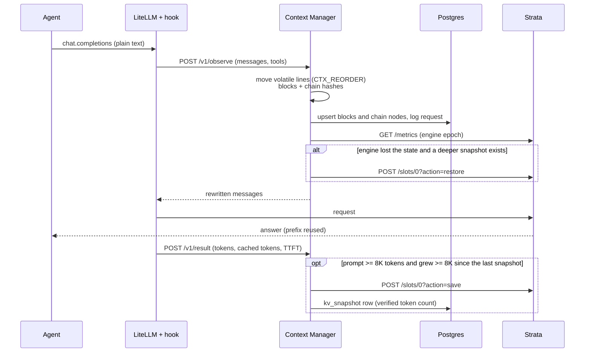
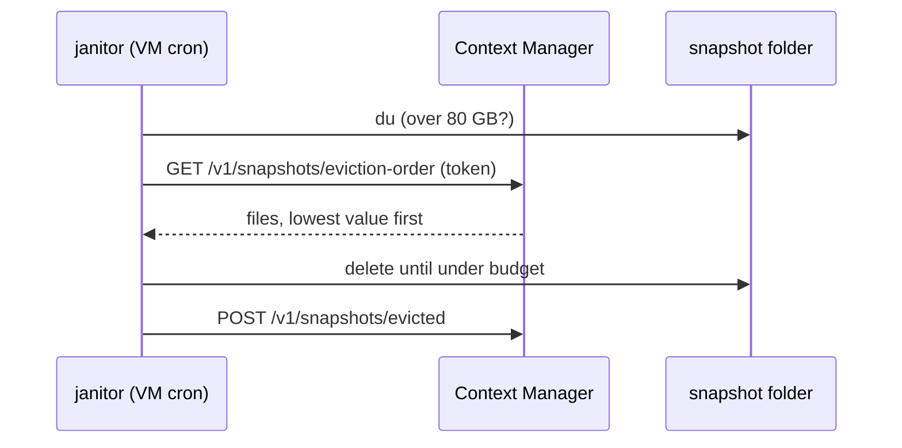

# Architecture

Strata on an AMD MI100 (SGLang cannot serve Qwen3.8-Flash-Next on gfx908; see WHY-QWEN3.8-FLASH-NEXT.md).
Clients send plain OpenAI requests; nothing in the client changes.

## Components

| Component | Where | Role |
|---|---|---|
| Agent (Hermes Agent, any OpenAI client) | anywhere | talks to LiteLLM with its own virtual key |
| LiteLLM + `strata_context_hook.py` | gateway, `:4000` | pre-call hook (observe, canonicalise, optional pin) and success hook (result) |
| Context Manager (FastAPI) | gateway, `:8090` | blocks, chain hashes, snapshot decisions, eviction ranking |
| PostgreSQL 16, database `context` | gateway | `context_block`, `chain_node`, `kv_snapshot`, `request_log`, `context_profile` |
| Strata server + engine | GPU machine, `:8080` | inference; `--slot-save-path DIR`; optionally kept alive by `strata-watchdog` |
| `strata-slots-janitor` | GPU machine, cron | keeps the snapshot folder under its budget, in the Context Manager's value order |

## Identity of cached state

- A **block** is a piece of the rendered request: the system message (cut by content-defined chunking at paragraph
  breaks), the tool definitions, each message (long ones chunked the same way). Its id is
  `sha256(kind \0 exact text)`; tool-call metadata is part of the text.
- The **validity root** is `sha256("ctxcache-v1|" + model | weights hash | quant | engine version | template hash)`.
  Any change gives new chains, so an old state can never match.
- The **chain hash** of block *i* is `sha256(chain(i-1) | block_hash(i))`, starting from the validity root. Two
  requests share a chain node exactly when they share the same prefix of blocks under the same validity tuple.
- A **snapshot** is a Strata slot file (`<chain hash[:40]>.bin`) holding the engine state after a request whose
  prompt ends at that chain node (plus the answer it generated). Strata checks tokens on restore and re-reads any
  mismatch, so a wrong match costs time, never correctness.

## Request flow

## Eviction

Value = P(reuse) × recompute cost / size, with P(reuse) = (hits+1)/(hits+2) × 0.5^(age_h/24); pinned snapshots are
never evicted. If the Context Manager is unreachable the janitor deletes oldest first.

## What each mechanism buys

Measured on one MI100 with Qwen3.8-Flash-Next IQ2_XS (details in BENCHMARK.md):

| Situation | Without | With |
|---|---|---|
| Next call in the same session | Strata's own cache: ~92% reused | same |
| First session of a new day (Hermes) | 10.5K-token system + tools re-read, 12.5 s | 0.9 s (date line moved) |
| Engine restart / GPU reset, ~38K-token conversation | 43.6 s re-read | 2.2 s (restore + 86 tokens) |
| Engine restart, 120K-token conversation | ~230 s | 3.0 s restore |

## Limits

- One request at a time on this engine: a save queued behind another conversation's request is detected (token
  count check) and marked stale.
- The tier-0 pin is off by default (KNOWN-ISSUES.md). When on: Strata pins one prefix per engine and the last request
  that asks wins it, so the Context Manager only asks for the most requested system + tools head of the last 6 h
  (`CTX_PIN_WINDOW_H`).
- LiteLLM's proxy drops an `extra_body` set by a pre-call hook; the hook therefore sends `strata_prefix` as a top-level
  key, which LiteLLM forwards to the `openai/` backend (verified by capturing the request on the Strata side).
- The Context Manager port must be reachable from the GPU machine (janitor); only the eviction endpoints need the token.
